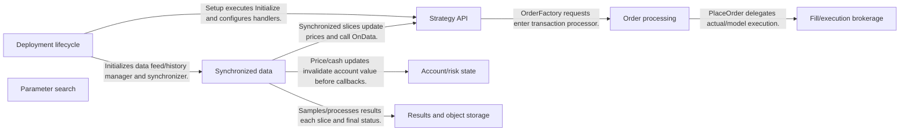
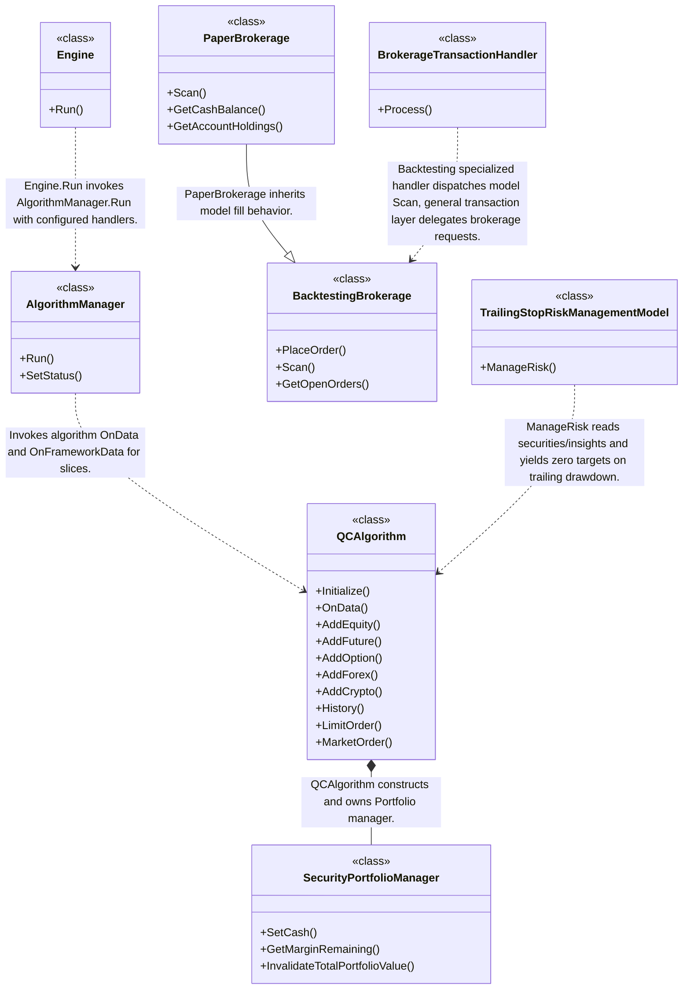
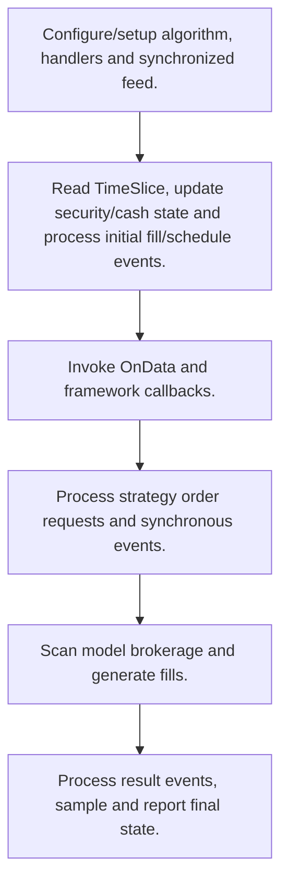
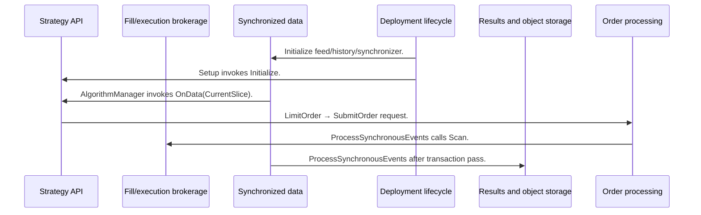

# LEAN: workflow, design and architecture

Updated: **2026-10-13**
Reviewed Git hash: `76d004a671cfbe9d0f0e21f8fb2e3b28ea668aaf`
Branch: `feature/ayu_develop`
Source diff SHA256: `e3b0c44298fc1c149afbf4c8996fb92427ae41e4649b934ca495991b7852b855`
Scope: **Multi-asset event-driven engine** / Maintenance: **active**
Languages: C#, Python

[HTML edition](ayu-develop.html) / [Development](development.md) / [Historical validation](validation.md) / [Full system comparison](../../docs/index.html)

## Purpose and scope

C# algorithm lifecycle and brokerage/data/model orchestration for historical simulation, live feeds and paper brokerage, with Python algorithm integration and modular portfolio/risk/optimization APIs.

## Features and support boundaries

Native = implemented here. Integration = supplied through a named host/API. Limited = material restriction. Not provided = evidenced scope exclusion. Unverified = support/absence not established. Not applicable = outside this artifact type.

| Capability | Status | Implementation and limits | Source |
|---|---|---|---|
| Backtesting | Native | QCAlgorithm callbacks, model/paper brokerage, request tickets, account state and trailing-risk targets are implemented. | [QCAlgorithm](../Algorithm/QCAlgorithm.cs) ([L70](https://github.com/alexcwyu/lean/blob/76d004a671cfbe9d0f0e21f8fb2e3b28ea668aaf/Algorithm/QCAlgorithm.cs#L70)) / [AlgorithmManager](../Engine/AlgorithmManager.cs) ([L47](https://github.com/alexcwyu/lean/blob/76d004a671cfbe9d0f0e21f8fb2e3b28ea668aaf/Engine/AlgorithmManager.cs#L47)) / [LimitOrder](../Algorithm/QCAlgorithm.Trading.cs) ([L410](https://github.com/alexcwyu/lean/blob/76d004a671cfbe9d0f0e21f8fb2e3b28ea668aaf/Algorithm/QCAlgorithm.Trading.cs#L410)) / [BacktestingBrokerage](../Brokerages/Backtesting/BacktestingBrokerage.cs) ([L38](https://github.com/alexcwyu/lean/blob/76d004a671cfbe9d0f0e21f8fb2e3b28ea668aaf/Brokerages/Backtesting/BacktestingBrokerage.cs#L38)) / [PaperBrokerage](../Brokerages/Paper/PaperBrokerage.cs) ([L29](https://github.com/alexcwyu/lean/blob/76d004a671cfbe9d0f0e21f8fb2e3b28ea668aaf/Brokerages/Paper/PaperBrokerage.cs#L29)) / [SecurityPortfolioManager](../Common/Securities/SecurityPortfolioManager.cs) ([L35](https://github.com/alexcwyu/lean/blob/76d004a671cfbe9d0f0e21f8fb2e3b28ea668aaf/Common/Securities/SecurityPortfolioManager.cs#L35)) / [TrailingStopRiskManagementModel](../Algorithm.Framework/Risk/TrailingStopRiskManagementModel.cs) ([L27](https://github.com/alexcwyu/lean/blob/76d004a671cfbe9d0f0e21f8fb2e3b28ea668aaf/Algorithm.Framework/Risk/TrailingStopRiskManagementModel.cs#L27)) |
| Live execution | Integration | Engine configures broker handlers and LiveTradingDataFeed queue subscriptions; actual external broker/data configuration is required. | [Engine](../Engine/Engine.cs) ([L49](https://github.com/alexcwyu/lean/blob/76d004a671cfbe9d0f0e21f8fb2e3b28ea668aaf/Engine/Engine.cs#L49)) / [LiveTradingDataFeed](../Engine/DataFeeds/LiveTradingDataFeed.cs) ([L41](https://github.com/alexcwyu/lean/blob/76d004a671cfbe9d0f0e21f8fb2e3b28ea668aaf/Engine/DataFeeds/LiveTradingDataFeed.cs#L41)) / [BrokerageTransactionHandler](../Engine/TransactionHandlers/BrokerageTransactionHandler.cs) ([L43](https://github.com/alexcwyu/lean/blob/76d004a671cfbe9d0f0e21f8fb2e3b28ea668aaf/Engine/TransactionHandlers/BrokerageTransactionHandler.cs#L43)) |
| Paper trading | Native | QCAlgorithm callbacks, model/paper brokerage, request tickets, account state and trailing-risk targets are implemented. | [QCAlgorithm](../Algorithm/QCAlgorithm.cs) ([L70](https://github.com/alexcwyu/lean/blob/76d004a671cfbe9d0f0e21f8fb2e3b28ea668aaf/Algorithm/QCAlgorithm.cs#L70)) / [AlgorithmManager](../Engine/AlgorithmManager.cs) ([L47](https://github.com/alexcwyu/lean/blob/76d004a671cfbe9d0f0e21f8fb2e3b28ea668aaf/Engine/AlgorithmManager.cs#L47)) / [LimitOrder](../Algorithm/QCAlgorithm.Trading.cs) ([L410](https://github.com/alexcwyu/lean/blob/76d004a671cfbe9d0f0e21f8fb2e3b28ea668aaf/Algorithm/QCAlgorithm.Trading.cs#L410)) / [BacktestingBrokerage](../Brokerages/Backtesting/BacktestingBrokerage.cs) ([L38](https://github.com/alexcwyu/lean/blob/76d004a671cfbe9d0f0e21f8fb2e3b28ea668aaf/Brokerages/Backtesting/BacktestingBrokerage.cs#L38)) / [PaperBrokerage](../Brokerages/Paper/PaperBrokerage.cs) ([L29](https://github.com/alexcwyu/lean/blob/76d004a671cfbe9d0f0e21f8fb2e3b28ea668aaf/Brokerages/Paper/PaperBrokerage.cs#L29)) / [SecurityPortfolioManager](../Common/Securities/SecurityPortfolioManager.cs) ([L35](https://github.com/alexcwyu/lean/blob/76d004a671cfbe9d0f0e21f8fb2e3b28ea668aaf/Common/Securities/SecurityPortfolioManager.cs#L35)) / [TrailingStopRiskManagementModel](../Algorithm.Framework/Risk/TrailingStopRiskManagementModel.cs) ([L27](https://github.com/alexcwyu/lean/blob/76d004a671cfbe9d0f0e21f8fb2e3b28ea668aaf/Algorithm.Framework/Risk/TrailingStopRiskManagementModel.cs#L27)) |
| Event driven | Native | QCAlgorithm callbacks, model/paper brokerage, request tickets, account state and trailing-risk targets are implemented. | [QCAlgorithm](../Algorithm/QCAlgorithm.cs) ([L70](https://github.com/alexcwyu/lean/blob/76d004a671cfbe9d0f0e21f8fb2e3b28ea668aaf/Algorithm/QCAlgorithm.cs#L70)) / [AlgorithmManager](../Engine/AlgorithmManager.cs) ([L47](https://github.com/alexcwyu/lean/blob/76d004a671cfbe9d0f0e21f8fb2e3b28ea668aaf/Engine/AlgorithmManager.cs#L47)) / [LimitOrder](../Algorithm/QCAlgorithm.Trading.cs) ([L410](https://github.com/alexcwyu/lean/blob/76d004a671cfbe9d0f0e21f8fb2e3b28ea668aaf/Algorithm/QCAlgorithm.Trading.cs#L410)) / [BacktestingBrokerage](../Brokerages/Backtesting/BacktestingBrokerage.cs) ([L38](https://github.com/alexcwyu/lean/blob/76d004a671cfbe9d0f0e21f8fb2e3b28ea668aaf/Brokerages/Backtesting/BacktestingBrokerage.cs#L38)) / [PaperBrokerage](../Brokerages/Paper/PaperBrokerage.cs) ([L29](https://github.com/alexcwyu/lean/blob/76d004a671cfbe9d0f0e21f8fb2e3b28ea668aaf/Brokerages/Paper/PaperBrokerage.cs#L29)) / [SecurityPortfolioManager](../Common/Securities/SecurityPortfolioManager.cs) ([L35](https://github.com/alexcwyu/lean/blob/76d004a671cfbe9d0f0e21f8fb2e3b28ea668aaf/Common/Securities/SecurityPortfolioManager.cs#L35)) / [TrailingStopRiskManagementModel](../Algorithm.Framework/Risk/TrailingStopRiskManagementModel.cs) ([L27](https://github.com/alexcwyu/lean/blob/76d004a671cfbe9d0f0e21f8fb2e3b28ea668aaf/Algorithm.Framework/Risk/TrailingStopRiskManagementModel.cs#L27)) |
| Vectorized | Unverified | Not established by the inspected implementation boundaries; no absence or production claim is made. | Not applicable to this repository scope. |
| Order management | Native | QCAlgorithm callbacks, model/paper brokerage, request tickets, account state and trailing-risk targets are implemented. | [QCAlgorithm](../Algorithm/QCAlgorithm.cs) ([L70](https://github.com/alexcwyu/lean/blob/76d004a671cfbe9d0f0e21f8fb2e3b28ea668aaf/Algorithm/QCAlgorithm.cs#L70)) / [AlgorithmManager](../Engine/AlgorithmManager.cs) ([L47](https://github.com/alexcwyu/lean/blob/76d004a671cfbe9d0f0e21f8fb2e3b28ea668aaf/Engine/AlgorithmManager.cs#L47)) / [LimitOrder](../Algorithm/QCAlgorithm.Trading.cs) ([L410](https://github.com/alexcwyu/lean/blob/76d004a671cfbe9d0f0e21f8fb2e3b28ea668aaf/Algorithm/QCAlgorithm.Trading.cs#L410)) / [BacktestingBrokerage](../Brokerages/Backtesting/BacktestingBrokerage.cs) ([L38](https://github.com/alexcwyu/lean/blob/76d004a671cfbe9d0f0e21f8fb2e3b28ea668aaf/Brokerages/Backtesting/BacktestingBrokerage.cs#L38)) / [PaperBrokerage](../Brokerages/Paper/PaperBrokerage.cs) ([L29](https://github.com/alexcwyu/lean/blob/76d004a671cfbe9d0f0e21f8fb2e3b28ea668aaf/Brokerages/Paper/PaperBrokerage.cs#L29)) / [SecurityPortfolioManager](../Common/Securities/SecurityPortfolioManager.cs) ([L35](https://github.com/alexcwyu/lean/blob/76d004a671cfbe9d0f0e21f8fb2e3b28ea668aaf/Common/Securities/SecurityPortfolioManager.cs#L35)) / [TrailingStopRiskManagementModel](../Algorithm.Framework/Risk/TrailingStopRiskManagementModel.cs) ([L27](https://github.com/alexcwyu/lean/blob/76d004a671cfbe9d0f0e21f8fb2e3b28ea668aaf/Algorithm.Framework/Risk/TrailingStopRiskManagementModel.cs#L27)) |
| Order types | Native | QCAlgorithm callbacks, model/paper brokerage, request tickets, account state and trailing-risk targets are implemented. | [QCAlgorithm](../Algorithm/QCAlgorithm.cs) ([L70](https://github.com/alexcwyu/lean/blob/76d004a671cfbe9d0f0e21f8fb2e3b28ea668aaf/Algorithm/QCAlgorithm.cs#L70)) / [AlgorithmManager](../Engine/AlgorithmManager.cs) ([L47](https://github.com/alexcwyu/lean/blob/76d004a671cfbe9d0f0e21f8fb2e3b28ea668aaf/Engine/AlgorithmManager.cs#L47)) / [LimitOrder](../Algorithm/QCAlgorithm.Trading.cs) ([L410](https://github.com/alexcwyu/lean/blob/76d004a671cfbe9d0f0e21f8fb2e3b28ea668aaf/Algorithm/QCAlgorithm.Trading.cs#L410)) / [BacktestingBrokerage](../Brokerages/Backtesting/BacktestingBrokerage.cs) ([L38](https://github.com/alexcwyu/lean/blob/76d004a671cfbe9d0f0e21f8fb2e3b28ea668aaf/Brokerages/Backtesting/BacktestingBrokerage.cs#L38)) / [PaperBrokerage](../Brokerages/Paper/PaperBrokerage.cs) ([L29](https://github.com/alexcwyu/lean/blob/76d004a671cfbe9d0f0e21f8fb2e3b28ea668aaf/Brokerages/Paper/PaperBrokerage.cs#L29)) / [SecurityPortfolioManager](../Common/Securities/SecurityPortfolioManager.cs) ([L35](https://github.com/alexcwyu/lean/blob/76d004a671cfbe9d0f0e21f8fb2e3b28ea668aaf/Common/Securities/SecurityPortfolioManager.cs#L35)) / [TrailingStopRiskManagementModel](../Algorithm.Framework/Risk/TrailingStopRiskManagementModel.cs) ([L27](https://github.com/alexcwyu/lean/blob/76d004a671cfbe9d0f0e21f8fb2e3b28ea668aaf/Algorithm.Framework/Risk/TrailingStopRiskManagementModel.cs#L27)) |
| Multi venue | Limited | Brokerage/data handlers are configurable integrations; inspected lifecycle selects a deployment brokerage rather than proving simultaneous multi-broker routing. | [Engine](../Engine/Engine.cs) ([L49](https://github.com/alexcwyu/lean/blob/76d004a671cfbe9d0f0e21f8fb2e3b28ea668aaf/Engine/Engine.cs#L49)) / [BrokerageTransactionHandler](../Engine/TransactionHandlers/BrokerageTransactionHandler.cs) ([L43](https://github.com/alexcwyu/lean/blob/76d004a671cfbe9d0f0e21f8fb2e3b28ea668aaf/Engine/TransactionHandlers/BrokerageTransactionHandler.cs#L43)) |
| Crypto | Native | Typed crypto security subscription construction exists; venue execution remains a configured brokerage integration. | [AddCrypto](../Algorithm/QCAlgorithm.cs) ([L2679](https://github.com/alexcwyu/lean/blob/76d004a671cfbe9d0f0e21f8fb2e3b28ea668aaf/Algorithm/QCAlgorithm.cs#L2679)) |
| Equities | Native | Typed equity security subscription construction exists. | [AddEquity](../Algorithm/QCAlgorithm.cs) ([L2221](https://github.com/alexcwyu/lean/blob/76d004a671cfbe9d0f0e21f8fb2e3b28ea668aaf/Algorithm/QCAlgorithm.cs#L2221)) |
| Futures | Native | Future canonical/contract subscriptions and model handling are present; endpoint data prerequisites remain external. | [AddFuture](../Algorithm/QCAlgorithm.cs) ([L2323](https://github.com/alexcwyu/lean/blob/76d004a671cfbe9d0f0e21f8fb2e3b28ea668aaf/Algorithm/QCAlgorithm.cs#L2323)) |
| Options | Native | Option subscription and backtesting option assignment/delisting machinery are present; data availability varies. | [AddOption](../Algorithm/QCAlgorithm.cs) ([L2237](https://github.com/alexcwyu/lean/blob/76d004a671cfbe9d0f0e21f8fb2e3b28ea668aaf/Algorithm/QCAlgorithm.cs#L2237)) / [BacktestingBrokerage](../Brokerages/Backtesting/BacktestingBrokerage.cs) ([L38](https://github.com/alexcwyu/lean/blob/76d004a671cfbe9d0f0e21f8fb2e3b28ea668aaf/Brokerages/Backtesting/BacktestingBrokerage.cs#L38)) |
| Forex | Native | Typed forex security subscription construction exists. | [AddForex](../Algorithm/QCAlgorithm.cs) ([L2633](https://github.com/alexcwyu/lean/blob/76d004a671cfbe9d0f0e21f8fb2e3b28ea668aaf/Algorithm/QCAlgorithm.cs#L2633)) |
| Strategy api | Native | QCAlgorithm callbacks, model/paper brokerage, request tickets, account state and trailing-risk targets are implemented. | [QCAlgorithm](../Algorithm/QCAlgorithm.cs) ([L70](https://github.com/alexcwyu/lean/blob/76d004a671cfbe9d0f0e21f8fb2e3b28ea668aaf/Algorithm/QCAlgorithm.cs#L70)) / [AlgorithmManager](../Engine/AlgorithmManager.cs) ([L47](https://github.com/alexcwyu/lean/blob/76d004a671cfbe9d0f0e21f8fb2e3b28ea668aaf/Engine/AlgorithmManager.cs#L47)) / [LimitOrder](../Algorithm/QCAlgorithm.Trading.cs) ([L410](https://github.com/alexcwyu/lean/blob/76d004a671cfbe9d0f0e21f8fb2e3b28ea668aaf/Algorithm/QCAlgorithm.Trading.cs#L410)) / [BacktestingBrokerage](../Brokerages/Backtesting/BacktestingBrokerage.cs) ([L38](https://github.com/alexcwyu/lean/blob/76d004a671cfbe9d0f0e21f8fb2e3b28ea668aaf/Brokerages/Backtesting/BacktestingBrokerage.cs#L38)) / [PaperBrokerage](../Brokerages/Paper/PaperBrokerage.cs) ([L29](https://github.com/alexcwyu/lean/blob/76d004a671cfbe9d0f0e21f8fb2e3b28ea668aaf/Brokerages/Paper/PaperBrokerage.cs#L29)) / [SecurityPortfolioManager](../Common/Securities/SecurityPortfolioManager.cs) ([L35](https://github.com/alexcwyu/lean/blob/76d004a671cfbe9d0f0e21f8fb2e3b28ea668aaf/Common/Securities/SecurityPortfolioManager.cs#L35)) / [TrailingStopRiskManagementModel](../Algorithm.Framework/Risk/TrailingStopRiskManagementModel.cs) ([L27](https://github.com/alexcwyu/lean/blob/76d004a671cfbe9d0f0e21f8fb2e3b28ea668aaf/Algorithm.Framework/Risk/TrailingStopRiskManagementModel.cs#L27)) |
| Optimization | Native | GridSearchOptimizationStrategy generates configured parameter sets and consumes backtest results. | [GridSearchOptimizationStrategy](../Optimizer/Strategies/GridSearchOptimizationStrategy.cs) ([L23](https://github.com/alexcwyu/lean/blob/76d004a671cfbe9d0f0e21f8fb2e3b28ea668aaf/Optimizer/Strategies/GridSearchOptimizationStrategy.cs#L23)) |
| Machine learning | Unverified | Not established by the inspected implementation boundaries; no absence or production claim is made. | Not applicable to this repository scope. |
| Reinforcement learning | Unverified | Not established by the inspected implementation boundaries; no absence or production claim is made. | Not applicable to this repository scope. |
| Portfolio | Native | QCAlgorithm callbacks, model/paper brokerage, request tickets, account state and trailing-risk targets are implemented. | [QCAlgorithm](../Algorithm/QCAlgorithm.cs) ([L70](https://github.com/alexcwyu/lean/blob/76d004a671cfbe9d0f0e21f8fb2e3b28ea668aaf/Algorithm/QCAlgorithm.cs#L70)) / [AlgorithmManager](../Engine/AlgorithmManager.cs) ([L47](https://github.com/alexcwyu/lean/blob/76d004a671cfbe9d0f0e21f8fb2e3b28ea668aaf/Engine/AlgorithmManager.cs#L47)) / [LimitOrder](../Algorithm/QCAlgorithm.Trading.cs) ([L410](https://github.com/alexcwyu/lean/blob/76d004a671cfbe9d0f0e21f8fb2e3b28ea668aaf/Algorithm/QCAlgorithm.Trading.cs#L410)) / [BacktestingBrokerage](../Brokerages/Backtesting/BacktestingBrokerage.cs) ([L38](https://github.com/alexcwyu/lean/blob/76d004a671cfbe9d0f0e21f8fb2e3b28ea668aaf/Brokerages/Backtesting/BacktestingBrokerage.cs#L38)) / [PaperBrokerage](../Brokerages/Paper/PaperBrokerage.cs) ([L29](https://github.com/alexcwyu/lean/blob/76d004a671cfbe9d0f0e21f8fb2e3b28ea668aaf/Brokerages/Paper/PaperBrokerage.cs#L29)) / [SecurityPortfolioManager](../Common/Securities/SecurityPortfolioManager.cs) ([L35](https://github.com/alexcwyu/lean/blob/76d004a671cfbe9d0f0e21f8fb2e3b28ea668aaf/Common/Securities/SecurityPortfolioManager.cs#L35)) / [TrailingStopRiskManagementModel](../Algorithm.Framework/Risk/TrailingStopRiskManagementModel.cs) ([L27](https://github.com/alexcwyu/lean/blob/76d004a671cfbe9d0f0e21f8fb2e3b28ea668aaf/Algorithm.Framework/Risk/TrailingStopRiskManagementModel.cs#L27)) |
| Risk management | Native | QCAlgorithm callbacks, model/paper brokerage, request tickets, account state and trailing-risk targets are implemented. | [QCAlgorithm](../Algorithm/QCAlgorithm.cs) ([L70](https://github.com/alexcwyu/lean/blob/76d004a671cfbe9d0f0e21f8fb2e3b28ea668aaf/Algorithm/QCAlgorithm.cs#L70)) / [AlgorithmManager](../Engine/AlgorithmManager.cs) ([L47](https://github.com/alexcwyu/lean/blob/76d004a671cfbe9d0f0e21f8fb2e3b28ea668aaf/Engine/AlgorithmManager.cs#L47)) / [LimitOrder](../Algorithm/QCAlgorithm.Trading.cs) ([L410](https://github.com/alexcwyu/lean/blob/76d004a671cfbe9d0f0e21f8fb2e3b28ea668aaf/Algorithm/QCAlgorithm.Trading.cs#L410)) / [BacktestingBrokerage](../Brokerages/Backtesting/BacktestingBrokerage.cs) ([L38](https://github.com/alexcwyu/lean/blob/76d004a671cfbe9d0f0e21f8fb2e3b28ea668aaf/Brokerages/Backtesting/BacktestingBrokerage.cs#L38)) / [PaperBrokerage](../Brokerages/Paper/PaperBrokerage.cs) ([L29](https://github.com/alexcwyu/lean/blob/76d004a671cfbe9d0f0e21f8fb2e3b28ea668aaf/Brokerages/Paper/PaperBrokerage.cs#L29)) / [SecurityPortfolioManager](../Common/Securities/SecurityPortfolioManager.cs) ([L35](https://github.com/alexcwyu/lean/blob/76d004a671cfbe9d0f0e21f8fb2e3b28ea668aaf/Common/Securities/SecurityPortfolioManager.cs#L35)) / [TrailingStopRiskManagementModel](../Algorithm.Framework/Risk/TrailingStopRiskManagementModel.cs) ([L27](https://github.com/alexcwyu/lean/blob/76d004a671cfbe9d0f0e21f8fb2e3b28ea668aaf/Algorithm.Framework/Risk/TrailingStopRiskManagementModel.cs#L27)) |
| Performance analytics | Native | AlgorithmManager samples results, updates run status and processes results after order events. | [AlgorithmManager](../Engine/AlgorithmManager.cs) ([L47](https://github.com/alexcwyu/lean/blob/76d004a671cfbe9d0f0e21f8fb2e3b28ea668aaf/Engine/AlgorithmManager.cs#L47)) / [Run](../Engine/AlgorithmManager.cs) ([L121](https://github.com/alexcwyu/lean/blob/76d004a671cfbe9d0f0e21f8fb2e3b28ea668aaf/Engine/AlgorithmManager.cs#L121)) |
| Historical data | Native | History request/slice API and synchronized feed pipeline are implemented; users supply/configure providers. | [History](../Algorithm/QCAlgorithm.History.cs) ([L243](https://github.com/alexcwyu/lean/blob/76d004a671cfbe9d0f0e21f8fb2e3b28ea668aaf/Algorithm/QCAlgorithm.History.cs#L243)) / [Engine](../Engine/Engine.cs) ([L49](https://github.com/alexcwyu/lean/blob/76d004a671cfbe9d0f0e21f8fb2e3b28ea668aaf/Engine/Engine.cs#L49)) / [AlgorithmManager](../Engine/AlgorithmManager.cs) ([L47](https://github.com/alexcwyu/lean/blob/76d004a671cfbe9d0f0e21f8fb2e3b28ea668aaf/Engine/AlgorithmManager.cs#L47)) |
| Streaming data | Integration | Engine configures broker handlers and LiveTradingDataFeed queue subscriptions; actual external broker/data configuration is required. | [Engine](../Engine/Engine.cs) ([L49](https://github.com/alexcwyu/lean/blob/76d004a671cfbe9d0f0e21f8fb2e3b28ea668aaf/Engine/Engine.cs#L49)) / [LiveTradingDataFeed](../Engine/DataFeeds/LiveTradingDataFeed.cs) ([L41](https://github.com/alexcwyu/lean/blob/76d004a671cfbe9d0f0e21f8fb2e3b28ea668aaf/Engine/DataFeeds/LiveTradingDataFeed.cs#L41)) / [BrokerageTransactionHandler](../Engine/TransactionHandlers/BrokerageTransactionHandler.cs) ([L43](https://github.com/alexcwyu/lean/blob/76d004a671cfbe9d0f0e21f8fb2e3b28ea668aaf/Engine/TransactionHandlers/BrokerageTransactionHandler.cs#L43)) |
| Persistence | Native | LocalObjectStore validates access/path and persists user byte artifacts. | [LocalObjectStore](../Engine/Storage/LocalObjectStore.cs) ([L36](https://github.com/alexcwyu/lean/blob/76d004a671cfbe9d0f0e21f8fb2e3b28ea668aaf/Engine/Storage/LocalObjectStore.cs#L36)) |
| Data pipeline | Native | History request/slice API and synchronized feed pipeline are implemented; users supply/configure providers. | [History](../Algorithm/QCAlgorithm.History.cs) ([L243](https://github.com/alexcwyu/lean/blob/76d004a671cfbe9d0f0e21f8fb2e3b28ea668aaf/Algorithm/QCAlgorithm.History.cs#L243)) / [Engine](../Engine/Engine.cs) ([L49](https://github.com/alexcwyu/lean/blob/76d004a671cfbe9d0f0e21f8fb2e3b28ea668aaf/Engine/Engine.cs#L49)) / [AlgorithmManager](../Engine/AlgorithmManager.cs) ([L47](https://github.com/alexcwyu/lean/blob/76d004a671cfbe9d0f0e21f8fb2e3b28ea668aaf/Engine/AlgorithmManager.cs#L47)) |
| Web ui | Unverified | Not established by the inspected implementation boundaries; no absence or production claim is made. | Not applicable to this repository scope. |
| Cli | Unverified | Not established by the inspected implementation boundaries; no absence or production claim is made. | Not applicable to this repository scope. |
| Monitoring | Native | AlgorithmManager samples results, updates run status and processes results after order events. | [AlgorithmManager](../Engine/AlgorithmManager.cs) ([L47](https://github.com/alexcwyu/lean/blob/76d004a671cfbe9d0f0e21f8fb2e3b28ea668aaf/Engine/AlgorithmManager.cs#L47)) / [Run](../Engine/AlgorithmManager.cs) ([L121](https://github.com/alexcwyu/lean/blob/76d004a671cfbe9d0f0e21f8fb2e3b28ea668aaf/Engine/AlgorithmManager.cs#L121)) |
| Extension api | Native | IAlgorithm/handler/brokerage/history/model boundaries support C# and Python algorithm integration. | [QCAlgorithm](../Algorithm/QCAlgorithm.cs) ([L70](https://github.com/alexcwyu/lean/blob/76d004a671cfbe9d0f0e21f8fb2e3b28ea668aaf/Algorithm/QCAlgorithm.cs#L70)) / [Engine](../Engine/Engine.cs) ([L49](https://github.com/alexcwyu/lean/blob/76d004a671cfbe9d0f0e21f8fb2e3b28ea668aaf/Engine/Engine.cs#L49)) / [BrokerageTransactionHandler](../Engine/TransactionHandlers/BrokerageTransactionHandler.cs) ([L43](https://github.com/alexcwyu/lean/blob/76d004a671cfbe9d0f0e21f8fb2e3b28ea668aaf/Engine/TransactionHandlers/BrokerageTransactionHandler.cs#L43)) |
| Native acceleration | Limited | Compiled C# engine with optional embedded Python algorithms; no source evidence for a universal speedup or SIMD/vectorized backtesting claim. | [Engine](../Engine/Engine.cs) ([L49](https://github.com/alexcwyu/lean/blob/76d004a671cfbe9d0f0e21f8fb2e3b28ea668aaf/Engine/Engine.cs#L49)) / [QCAlgorithm](../Algorithm/QCAlgorithm.cs) ([L70](https://github.com/alexcwyu/lean/blob/76d004a671cfbe9d0f0e21f8fb2e3b28ea668aaf/Algorithm/QCAlgorithm.cs#L70)) |
| Distributed execution | Unverified | Not established by the inspected implementation boundaries; no absence or production claim is made. | Not applicable to this repository scope. |

## System components

| Component | Responsibility | Source |
|---|---|---|
| Deployment lifecycle | Builds configured handlers and runs algorithm manager. | [Engine](../Engine/Engine.cs) ([L49](https://github.com/alexcwyu/lean/blob/76d004a671cfbe9d0f0e21f8fb2e3b28ea668aaf/Engine/Engine.cs#L49)) |
| Synchronized data | TimeSlice stream joins historical/live/custom subscriptions. | [AlgorithmManager](../Engine/AlgorithmManager.cs) ([L47](https://github.com/alexcwyu/lean/blob/76d004a671cfbe9d0f0e21f8fb2e3b28ea668aaf/Engine/AlgorithmManager.cs#L47)) / [LiveTradingDataFeed](../Engine/DataFeeds/LiveTradingDataFeed.cs) ([L41](https://github.com/alexcwyu/lean/blob/76d004a671cfbe9d0f0e21f8fb2e3b28ea668aaf/Engine/DataFeeds/LiveTradingDataFeed.cs#L41)) / [History](../Algorithm/QCAlgorithm.History.cs) ([L243](https://github.com/alexcwyu/lean/blob/76d004a671cfbe9d0f0e21f8fb2e3b28ea668aaf/Algorithm/QCAlgorithm.History.cs#L243)) |
| Strategy API | QCAlgorithm security subscriptions and OnData/framework callbacks. | [QCAlgorithm](../Algorithm/QCAlgorithm.cs) ([L70](https://github.com/alexcwyu/lean/blob/76d004a671cfbe9d0f0e21f8fb2e3b28ea668aaf/Algorithm/QCAlgorithm.cs#L70)) / [LimitOrder](../Algorithm/QCAlgorithm.Trading.cs) ([L410](https://github.com/alexcwyu/lean/blob/76d004a671cfbe9d0f0e21f8fb2e3b28ea668aaf/Algorithm/QCAlgorithm.Trading.cs#L410)) / [AddEquity](../Algorithm/QCAlgorithm.cs) ([L2221](https://github.com/alexcwyu/lean/blob/76d004a671cfbe9d0f0e21f8fb2e3b28ea668aaf/Algorithm/QCAlgorithm.cs#L2221)) / [AddFuture](../Algorithm/QCAlgorithm.cs) ([L2323](https://github.com/alexcwyu/lean/blob/76d004a671cfbe9d0f0e21f8fb2e3b28ea668aaf/Algorithm/QCAlgorithm.cs#L2323)) / [AddOption](../Algorithm/QCAlgorithm.cs) ([L2237](https://github.com/alexcwyu/lean/blob/76d004a671cfbe9d0f0e21f8fb2e3b28ea668aaf/Algorithm/QCAlgorithm.cs#L2237)) |
| Order processing | Tickets, request queues and brokerage fill/order notifications. | [BrokerageTransactionHandler](../Engine/TransactionHandlers/BrokerageTransactionHandler.cs) ([L43](https://github.com/alexcwyu/lean/blob/76d004a671cfbe9d0f0e21f8fb2e3b28ea668aaf/Engine/TransactionHandlers/BrokerageTransactionHandler.cs#L43)) / [ProcessSynchronousEvents](../Engine/TransactionHandlers/BacktestingTransactionHandler.cs) ([L70](https://github.com/alexcwyu/lean/blob/76d004a671cfbe9d0f0e21f8fb2e3b28ea668aaf/Engine/TransactionHandlers/BacktestingTransactionHandler.cs#L70)) |
| Fill/execution brokerage | Historical model fills, paper/live job brokerage integration. | [BacktestingBrokerage](../Brokerages/Backtesting/BacktestingBrokerage.cs) ([L38](https://github.com/alexcwyu/lean/blob/76d004a671cfbe9d0f0e21f8fb2e3b28ea668aaf/Brokerages/Backtesting/BacktestingBrokerage.cs#L38)) / [PaperBrokerage](../Brokerages/Paper/PaperBrokerage.cs) ([L29](https://github.com/alexcwyu/lean/blob/76d004a671cfbe9d0f0e21f8fb2e3b28ea668aaf/Brokerages/Paper/PaperBrokerage.cs#L29)) / [BrokerageTransactionHandler](../Engine/TransactionHandlers/BrokerageTransactionHandler.cs) ([L43](https://github.com/alexcwyu/lean/blob/76d004a671cfbe9d0f0e21f8fb2e3b28ea668aaf/Engine/TransactionHandlers/BrokerageTransactionHandler.cs#L43)) |
| Account/risk state | Holdings, cash, portfolio value and risk target changes. | [SecurityPortfolioManager](../Common/Securities/SecurityPortfolioManager.cs) ([L35](https://github.com/alexcwyu/lean/blob/76d004a671cfbe9d0f0e21f8fb2e3b28ea668aaf/Common/Securities/SecurityPortfolioManager.cs#L35)) / [TrailingStopRiskManagementModel](../Algorithm.Framework/Risk/TrailingStopRiskManagementModel.cs) ([L27](https://github.com/alexcwyu/lean/blob/76d004a671cfbe9d0f0e21f8fb2e3b28ea668aaf/Algorithm.Framework/Risk/TrailingStopRiskManagementModel.cs#L27)) |
| Results and object storage | Per-slice sampling/status and persisted user artifacts. | [AlgorithmManager](../Engine/AlgorithmManager.cs) ([L47](https://github.com/alexcwyu/lean/blob/76d004a671cfbe9d0f0e21f8fb2e3b28ea668aaf/Engine/AlgorithmManager.cs#L47)) / [LocalObjectStore](../Engine/Storage/LocalObjectStore.cs) ([L36](https://github.com/alexcwyu/lean/blob/76d004a671cfbe9d0f0e21f8fb2e3b28ea668aaf/Engine/Storage/LocalObjectStore.cs#L36)) |
| Parameter search | Generates grid parameter sets and consumes evaluation results. | [GridSearchOptimizationStrategy](../Optimizer/Strategies/GridSearchOptimizationStrategy.cs) ([L23](https://github.com/alexcwyu/lean/blob/76d004a671cfbe9d0f0e21f8fb2e3b28ea668aaf/Optimizer/Strategies/GridSearchOptimizationStrategy.cs#L23)) |

## Architecture and component boundaries

The component view summarizes inspected responsibility boundaries. Arrows identify the documented API/data dependencies; this is not a deployment-readiness claim.

- Initializes data feed/history manager and synchronizer.: [Engine](../Engine/Engine.cs) ([L49](https://github.com/alexcwyu/lean/blob/76d004a671cfbe9d0f0e21f8fb2e3b28ea668aaf/Engine/Engine.cs#L49))
- Setup executes Initialize and configures handlers.: [Engine](../Engine/Engine.cs) ([L49](https://github.com/alexcwyu/lean/blob/76d004a671cfbe9d0f0e21f8fb2e3b28ea668aaf/Engine/Engine.cs#L49)) / [QCAlgorithm](../Algorithm/QCAlgorithm.cs) ([L70](https://github.com/alexcwyu/lean/blob/76d004a671cfbe9d0f0e21f8fb2e3b28ea668aaf/Algorithm/QCAlgorithm.cs#L70))
- Synchronized slices update prices and call OnData.: [AlgorithmManager](../Engine/AlgorithmManager.cs) ([L47](https://github.com/alexcwyu/lean/blob/76d004a671cfbe9d0f0e21f8fb2e3b28ea668aaf/Engine/AlgorithmManager.cs#L47)) / [Run](../Engine/AlgorithmManager.cs) ([L121](https://github.com/alexcwyu/lean/blob/76d004a671cfbe9d0f0e21f8fb2e3b28ea668aaf/Engine/AlgorithmManager.cs#L121))
- OrderFactory requests enter transaction processor.: [LimitOrder](../Algorithm/QCAlgorithm.Trading.cs) ([L410](https://github.com/alexcwyu/lean/blob/76d004a671cfbe9d0f0e21f8fb2e3b28ea668aaf/Algorithm/QCAlgorithm.Trading.cs#L410)) / [BrokerageTransactionHandler](../Engine/TransactionHandlers/BrokerageTransactionHandler.cs) ([L43](https://github.com/alexcwyu/lean/blob/76d004a671cfbe9d0f0e21f8fb2e3b28ea668aaf/Engine/TransactionHandlers/BrokerageTransactionHandler.cs#L43))
- PlaceOrder delegates actual/model execution.: [BrokerageTransactionHandler](../Engine/TransactionHandlers/BrokerageTransactionHandler.cs) ([L43](https://github.com/alexcwyu/lean/blob/76d004a671cfbe9d0f0e21f8fb2e3b28ea668aaf/Engine/TransactionHandlers/BrokerageTransactionHandler.cs#L43)) / [ProcessSynchronousEvents](../Engine/TransactionHandlers/BacktestingTransactionHandler.cs) ([L70](https://github.com/alexcwyu/lean/blob/76d004a671cfbe9d0f0e21f8fb2e3b28ea668aaf/Engine/TransactionHandlers/BacktestingTransactionHandler.cs#L70))
- Price/cash updates invalidate account value before callbacks.: [AlgorithmManager](../Engine/AlgorithmManager.cs) ([L47](https://github.com/alexcwyu/lean/blob/76d004a671cfbe9d0f0e21f8fb2e3b28ea668aaf/Engine/AlgorithmManager.cs#L47)) / [SecurityPortfolioManager](../Common/Securities/SecurityPortfolioManager.cs) ([L35](https://github.com/alexcwyu/lean/blob/76d004a671cfbe9d0f0e21f8fb2e3b28ea668aaf/Common/Securities/SecurityPortfolioManager.cs#L35))
- Samples/processes results each slice and final status.: [AlgorithmManager](../Engine/AlgorithmManager.cs) ([L47](https://github.com/alexcwyu/lean/blob/76d004a671cfbe9d0f0e21f8fb2e3b28ea668aaf/Engine/AlgorithmManager.cs#L47))

## Design decisions

| Decision | Rationale | Tradeoff | Evidence |
|---|---|---|---|
| Configure handlers around one algorithm lifecycle. | Setup/data/history/transactions/results can vary between deployment modes. | Operational behavior and venue support depend on configuration and external implementations. | [Engine](../Engine/Engine.cs) ([L49](https://github.com/alexcwyu/lean/blob/76d004a671cfbe9d0f0e21f8fb2e3b28ea668aaf/Engine/Engine.cs#L49)) |
| Process prices and pending fills before strategy callbacks, then orders/results after them. | Algorithm observes synchronized market/account state while newly submitted orders are progressed within the slice. | Model fill timing must be understood before comparing to live asynchronous execution. | [AlgorithmManager](../Engine/AlgorithmManager.cs) ([L47](https://github.com/alexcwyu/lean/blob/76d004a671cfbe9d0f0e21f8fb2e3b28ea668aaf/Engine/AlgorithmManager.cs#L47)) / [Run](../Engine/AlgorithmManager.cs) ([L121](https://github.com/alexcwyu/lean/blob/76d004a671cfbe9d0f0e21f8fb2e3b28ea668aaf/Engine/AlgorithmManager.cs#L121)) / [ProcessSynchronousEvents](../Engine/TransactionHandlers/BacktestingTransactionHandler.cs) ([L70](https://github.com/alexcwyu/lean/blob/76d004a671cfbe9d0f0e21f8fb2e3b28ea668aaf/Engine/TransactionHandlers/BacktestingTransactionHandler.cs#L70)) |

## Class and interface relationships

Each node is a reviewed source symbol. Function/module nodes are explicitly labeled; they do not imply Python classes. Only reviewed relationships are drawn.

- **Engine** (class): [Engine](../Engine/Engine.cs) ([L49](https://github.com/alexcwyu/lean/blob/76d004a671cfbe9d0f0e21f8fb2e3b28ea668aaf/Engine/Engine.cs#L49))
- **AlgorithmManager** (class): [AlgorithmManager](../Engine/AlgorithmManager.cs) ([L47](https://github.com/alexcwyu/lean/blob/76d004a671cfbe9d0f0e21f8fb2e3b28ea668aaf/Engine/AlgorithmManager.cs#L47))
- **QCAlgorithm** (class): [QCAlgorithm](../Algorithm/QCAlgorithm.cs) ([L70](https://github.com/alexcwyu/lean/blob/76d004a671cfbe9d0f0e21f8fb2e3b28ea668aaf/Algorithm/QCAlgorithm.cs#L70)) / [LimitOrder](../Algorithm/QCAlgorithm.Trading.cs) ([L410](https://github.com/alexcwyu/lean/blob/76d004a671cfbe9d0f0e21f8fb2e3b28ea668aaf/Algorithm/QCAlgorithm.Trading.cs#L410)) / [History](../Algorithm/QCAlgorithm.History.cs) ([L243](https://github.com/alexcwyu/lean/blob/76d004a671cfbe9d0f0e21f8fb2e3b28ea668aaf/Algorithm/QCAlgorithm.History.cs#L243))
- **BrokerageTransactionHandler** (class): [BrokerageTransactionHandler](../Engine/TransactionHandlers/BrokerageTransactionHandler.cs) ([L43](https://github.com/alexcwyu/lean/blob/76d004a671cfbe9d0f0e21f8fb2e3b28ea668aaf/Engine/TransactionHandlers/BrokerageTransactionHandler.cs#L43))
- **BacktestingBrokerage** (class): [BacktestingBrokerage](../Brokerages/Backtesting/BacktestingBrokerage.cs) ([L38](https://github.com/alexcwyu/lean/blob/76d004a671cfbe9d0f0e21f8fb2e3b28ea668aaf/Brokerages/Backtesting/BacktestingBrokerage.cs#L38))
- **PaperBrokerage** (class): [PaperBrokerage](../Brokerages/Paper/PaperBrokerage.cs) ([L29](https://github.com/alexcwyu/lean/blob/76d004a671cfbe9d0f0e21f8fb2e3b28ea668aaf/Brokerages/Paper/PaperBrokerage.cs#L29))
- **SecurityPortfolioManager** (class): [SecurityPortfolioManager](../Common/Securities/SecurityPortfolioManager.cs) ([L35](https://github.com/alexcwyu/lean/blob/76d004a671cfbe9d0f0e21f8fb2e3b28ea668aaf/Common/Securities/SecurityPortfolioManager.cs#L35))
- **TrailingStopRiskManagementModel** (class): [TrailingStopRiskManagementModel](../Algorithm.Framework/Risk/TrailingStopRiskManagementModel.cs) ([L27](https://github.com/alexcwyu/lean/blob/76d004a671cfbe9d0f0e21f8fb2e3b28ea668aaf/Algorithm.Framework/Risk/TrailingStopRiskManagementModel.cs#L27))

## Workflow

### Historical slice and order processing

Representative historical/paper slice order. Live brokerage order acknowledgments are asynchronous and configured data/venue prerequisites remain external; no live account was run in this audit.

1. Configure/setup algorithm, handlers and synchronized feed.. [Engine](../Engine/Engine.cs) ([L49](https://github.com/alexcwyu/lean/blob/76d004a671cfbe9d0f0e21f8fb2e3b28ea668aaf/Engine/Engine.cs#L49))
2. Read TimeSlice, update security/cash state and process initial fill/schedule events.. [AlgorithmManager](../Engine/AlgorithmManager.cs) ([L47](https://github.com/alexcwyu/lean/blob/76d004a671cfbe9d0f0e21f8fb2e3b28ea668aaf/Engine/AlgorithmManager.cs#L47))
3. Invoke OnData and framework callbacks.. [Run](../Engine/AlgorithmManager.cs) ([L121](https://github.com/alexcwyu/lean/blob/76d004a671cfbe9d0f0e21f8fb2e3b28ea668aaf/Engine/AlgorithmManager.cs#L121))
4. Process strategy order requests and synchronous events.. [LimitOrder](../Algorithm/QCAlgorithm.Trading.cs) ([L410](https://github.com/alexcwyu/lean/blob/76d004a671cfbe9d0f0e21f8fb2e3b28ea668aaf/Algorithm/QCAlgorithm.Trading.cs#L410)) / [BrokerageTransactionHandler](../Engine/TransactionHandlers/BrokerageTransactionHandler.cs) ([L43](https://github.com/alexcwyu/lean/blob/76d004a671cfbe9d0f0e21f8fb2e3b28ea668aaf/Engine/TransactionHandlers/BrokerageTransactionHandler.cs#L43)) / [ProcessSynchronousEvents](../Engine/TransactionHandlers/BacktestingTransactionHandler.cs) ([L70](https://github.com/alexcwyu/lean/blob/76d004a671cfbe9d0f0e21f8fb2e3b28ea668aaf/Engine/TransactionHandlers/BacktestingTransactionHandler.cs#L70))
5. Scan model brokerage and generate fills.. [ProcessSynchronousEvents](../Engine/TransactionHandlers/BacktestingTransactionHandler.cs) ([L70](https://github.com/alexcwyu/lean/blob/76d004a671cfbe9d0f0e21f8fb2e3b28ea668aaf/Engine/TransactionHandlers/BacktestingTransactionHandler.cs#L70)) / [BacktestingBrokerage](../Brokerages/Backtesting/BacktestingBrokerage.cs) ([L38](https://github.com/alexcwyu/lean/blob/76d004a671cfbe9d0f0e21f8fb2e3b28ea668aaf/Brokerages/Backtesting/BacktestingBrokerage.cs#L38))
6. Process result events, sample and report final state.. [AlgorithmManager](../Engine/AlgorithmManager.cs) ([L47](https://github.com/alexcwyu/lean/blob/76d004a671cfbe9d0f0e21f8fb2e3b28ea668aaf/Engine/AlgorithmManager.cs#L47))

## Sequence

Historical slice and order processing

Representative historical/paper slice order. Live brokerage order acknowledgments are asynchronous and configured data/venue prerequisites remain external; no live account was run in this audit.

- Initialize feed/history/synchronizer.: [Engine](../Engine/Engine.cs) ([L49](https://github.com/alexcwyu/lean/blob/76d004a671cfbe9d0f0e21f8fb2e3b28ea668aaf/Engine/Engine.cs#L49))
- Setup invokes Initialize.: [Engine](../Engine/Engine.cs) ([L49](https://github.com/alexcwyu/lean/blob/76d004a671cfbe9d0f0e21f8fb2e3b28ea668aaf/Engine/Engine.cs#L49)) / [QCAlgorithm](../Algorithm/QCAlgorithm.cs) ([L70](https://github.com/alexcwyu/lean/blob/76d004a671cfbe9d0f0e21f8fb2e3b28ea668aaf/Algorithm/QCAlgorithm.cs#L70))
- AlgorithmManager invokes OnData(CurrentSlice).: [Run](../Engine/AlgorithmManager.cs) ([L121](https://github.com/alexcwyu/lean/blob/76d004a671cfbe9d0f0e21f8fb2e3b28ea668aaf/Engine/AlgorithmManager.cs#L121))
- LimitOrder → SubmitOrder request.: [LimitOrder](../Algorithm/QCAlgorithm.Trading.cs) ([L410](https://github.com/alexcwyu/lean/blob/76d004a671cfbe9d0f0e21f8fb2e3b28ea668aaf/Algorithm/QCAlgorithm.Trading.cs#L410))
- ProcessSynchronousEvents calls Scan.: [ProcessSynchronousEvents](../Engine/TransactionHandlers/BacktestingTransactionHandler.cs) ([L70](https://github.com/alexcwyu/lean/blob/76d004a671cfbe9d0f0e21f8fb2e3b28ea668aaf/Engine/TransactionHandlers/BacktestingTransactionHandler.cs#L70))
- ProcessSynchronousEvents after transaction pass.: [Run](../Engine/AlgorithmManager.cs) ([L121](https://github.com/alexcwyu/lean/blob/76d004a671cfbe9d0f0e21f8fb2e3b28ea668aaf/Engine/AlgorithmManager.cs#L121))

## Strengths and limits

### Strengths

- Actual multi-asset subscription, portfolio/account and model-risk boundaries are integrated into the event lifecycle. [QCAlgorithm](../Algorithm/QCAlgorithm.cs) ([L70](https://github.com/alexcwyu/lean/blob/76d004a671cfbe9d0f0e21f8fb2e3b28ea668aaf/Algorithm/QCAlgorithm.cs#L70)) / [SecurityPortfolioManager](../Common/Securities/SecurityPortfolioManager.cs) ([L35](https://github.com/alexcwyu/lean/blob/76d004a671cfbe9d0f0e21f8fb2e3b28ea668aaf/Common/Securities/SecurityPortfolioManager.cs#L35)) / [TrailingStopRiskManagementModel](../Algorithm.Framework/Risk/TrailingStopRiskManagementModel.cs) ([L27](https://github.com/alexcwyu/lean/blob/76d004a671cfbe9d0f0e21f8fb2e3b28ea668aaf/Algorithm.Framework/Risk/TrailingStopRiskManagementModel.cs#L27))

### Limitations

- The disabled live CME option-chain case is an explicit user policy exception after an HTTP404; this does not establish working live option data. [docs/validation.md](../docs/validation.md) ([L16](https://github.com/alexcwyu/lean/blob/76d004a671cfbe9d0f0e21f8fb2e3b28ea668aaf/docs/validation.md#L10))
- External brokerage/data credentials and complete market depth/queue realism are not established by the representative lifecycle audit. [Engine](../Engine/Engine.cs) ([L49](https://github.com/alexcwyu/lean/blob/76d004a671cfbe9d0f0e21f8fb2e3b28ea668aaf/Engine/Engine.cs#L49)) / [LiveTradingDataFeed](../Engine/DataFeeds/LiveTradingDataFeed.cs) ([L41](https://github.com/alexcwyu/lean/blob/76d004a671cfbe9d0f0e21f8fb2e3b28ea668aaf/Engine/DataFeeds/LiveTradingDataFeed.cs#L41)) / [BacktestingBrokerage](../Brokerages/Backtesting/BacktestingBrokerage.cs) ([L38](https://github.com/alexcwyu/lean/blob/76d004a671cfbe9d0f0e21f8fb2e3b28ea668aaf/Brokerages/Backtesting/BacktestingBrokerage.cs#L38))

## Validation scope

The linked validation and command records preserve actual historical runs and user-authorized exclusions. This source/document review does not rerun application tests, establish live trading readiness or rank benchmark performance. Current data, credential and runtime prerequisites remain material.

[Repository validation](validation.md) / [Executed checks](maintenance/index.md)

## Source map

| Reviewed symbol/path | Inspected responsibility | Actual file SHA256 |
|---|---|---|
| [Engine](../Engine/Engine.cs) ([L49](https://github.com/alexcwyu/lean/blob/76d004a671cfbe9d0f0e21f8fb2e3b28ea668aaf/Engine/Engine.cs#L49)) | Configures algorithm handlers, setup/history/data permissions, data manager, synchronizer, transaction processor and results; then calls AlgorithmManager.Run. | `408483f32a11543820067835fc8d44db9722f8ee2cb4b74f6491e0377b1a2ae8` |
| [AlgorithmManager](../Engine/AlgorithmManager.cs) ([L47](https://github.com/alexcwyu/lean/blob/76d004a671cfbe9d0f0e21f8fb2e3b28ea668aaf/Engine/AlgorithmManager.cs#L47)) | Iterates synchronized TimeSlices, updates security prices/cash, handles scheduled/consolidated events, invokes OnData/framework, processes transactions and samples results. | `c20e267cbd2a58b829587b7182966c5edf90a093ce98ac45dab64562adc2440f` |
| [Run](../Engine/AlgorithmManager.cs) ([L121](https://github.com/alexcwyu/lean/blob/76d004a671cfbe9d0f0e21f8fb2e3b28ea668aaf/Engine/AlgorithmManager.cs#L121)) | Run implementation: prices/cash and initial transaction events precede OnData at line 585; framework callbacks follow, then synchronous transactions at line 601 and results at line 605. Anchor is Run declaration; cited body locations establish order. | `c20e267cbd2a58b829587b7182966c5edf90a093ce98ac45dab64562adc2440f` |
| [QCAlgorithm](../Algorithm/QCAlgorithm.cs) ([L70](https://github.com/alexcwyu/lean/blob/76d004a671cfbe9d0f0e21f8fb2e3b28ea668aaf/Algorithm/QCAlgorithm.cs#L70)) | Concrete extensible algorithm initializes SecurityTransactionManager and SecurityPortfolioManager; Initialize/OnData are overridable strategy callbacks. | `827af5d3745d3c792ab9dba228d5fbb68cb08f5eae01c141e1cac015671eef11` |
| [AddEquity](../Algorithm/QCAlgorithm.cs) ([L2221](https://github.com/alexcwyu/lean/blob/76d004a671cfbe9d0f0e21f8fb2e3b28ea668aaf/Algorithm/QCAlgorithm.cs#L2221)) | Delegates to typed AddSecurity<Equity>; other inspected AddForex/AddCrypto similarly configure security subscriptions. | `827af5d3745d3c792ab9dba228d5fbb68cb08f5eae01c141e1cac015671eef11` |
| [AddFuture](../Algorithm/QCAlgorithm.cs) ([L2323](https://github.com/alexcwyu/lean/blob/76d004a671cfbe9d0f0e21f8fb2e3b28ea668aaf/Algorithm/QCAlgorithm.cs#L2323)) | Builds canonical future symbol and subscription through security/market configuration; future contract and future-option subscription APIs also exist. | `827af5d3745d3c792ab9dba228d5fbb68cb08f5eae01c141e1cac015671eef11` |
| [AddOption](../Algorithm/QCAlgorithm.cs) ([L2237](https://github.com/alexcwyu/lean/blob/76d004a671cfbe9d0f0e21f8fb2e3b28ea668aaf/Algorithm/QCAlgorithm.cs#L2237)) | Adds the underlying equity when needed and delegates to option subscription construction. | `827af5d3745d3c792ab9dba228d5fbb68cb08f5eae01c141e1cac015671eef11` |
| [AddForex](../Algorithm/QCAlgorithm.cs) ([L2633](https://github.com/alexcwyu/lean/blob/76d004a671cfbe9d0f0e21f8fb2e3b28ea668aaf/Algorithm/QCAlgorithm.cs#L2633)) | Delegates to typed forex security and configured market subscription. | `827af5d3745d3c792ab9dba228d5fbb68cb08f5eae01c141e1cac015671eef11` |
| [AddCrypto](../Algorithm/QCAlgorithm.cs) ([L2679](https://github.com/alexcwyu/lean/blob/76d004a671cfbe9d0f0e21f8fb2e3b28ea668aaf/Algorithm/QCAlgorithm.cs#L2679)) | Delegates to typed crypto security and configured market subscription. | `827af5d3745d3c792ab9dba228d5fbb68cb08f5eae01c141e1cac015671eef11` |
| [LimitOrder](../Algorithm/QCAlgorithm.Trading.cs) ([L410](https://github.com/alexcwyu/lean/blob/76d004a671cfbe9d0f0e21f8fb2e3b28ea668aaf/Algorithm/QCAlgorithm.Trading.cs#L410)) | Builds OrderFactory.LimitOrder and calls SubmitOrder; Market/StopMarket/StopLimit/TrailingStop public overloads inspected. | `a8c279c5568d5d67773f3064f1551b4b269613a82d3032ef49279cc0428f4d6f` |
| [BrokerageTransactionHandler](../Engine/TransactionHandlers/BrokerageTransactionHandler.cs) ([L43](https://github.com/alexcwyu/lean/blob/76d004a671cfbe9d0f0e21f8fb2e3b28ea668aaf/Engine/TransactionHandlers/BrokerageTransactionHandler.cs#L43)) | Processes OrderRequest into tickets and submits concrete orders via _brokerage.PlaceOrder; subscribes to fill/order notifications and starts transaction processing. | `7eb8d10b2582c8f4d1a4578eaa4db66c021b70305abcbff378f0c899be95a00c` |
| [ProcessSynchronousEvents](../Engine/TransactionHandlers/BacktestingTransactionHandler.cs) ([L70](https://github.com/alexcwyu/lean/blob/76d004a671cfbe9d0f0e21f8fb2e3b28ea668aaf/Engine/TransactionHandlers/BacktestingTransactionHandler.cs#L70)) | Drains pending requests when synchronous, calls base transaction processing then _brokerage.Scan and handles delistings. | `df5b3565fa4f67e504252d1b70320394c8be4e0bbebbe17317d6fa827d85f05e` |
| [BacktestingBrokerage](../Brokerages/Backtesting/BacktestingBrokerage.cs) ([L38](https://github.com/alexcwyu/lean/blob/76d004a671cfbe9d0f0e21f8fb2e3b28ea668aaf/Brokerages/Backtesting/BacktestingBrokerage.cs#L38)) | Maintains pending orders and uses model fills during Scan; specialized for BacktestingTransactionHandler. | `9425f67eff7fe1457985a5a70985801f9db962db08878b80a49b8802624e942c` |
| [PaperBrokerage](../Brokerages/Paper/PaperBrokerage.cs) ([L29](https://github.com/alexcwyu/lean/blob/76d004a671cfbe9d0f0e21f8fb2e3b28ea668aaf/Brokerages/Paper/PaperBrokerage.cs#L29)) | Inherits model-fill brokerage for live job, obtains configured balances/holdings and overrides Scan to apply dividends before base scan. | `c2383a396c7c0f2ea8e405c10c97e885f33340b6c62ea25b985411cacd1e4303` |
| [LiveTradingDataFeed](../Engine/DataFeeds/LiveTradingDataFeed.cs) ([L41](https://github.com/alexcwyu/lean/blob/76d004a671cfbe9d0f0e21f8fb2e3b28ea668aaf/Engine/DataFeeds/LiveTradingDataFeed.cs#L41)) | Initialize selects queue handler, attaches job, starts custom exchange and builds requested data/universe subscriptions. | `9cfd0e83102f8679eca7fe91d50e5f7547e54f547a52f04c53b82e54cba4a004` |
| [SecurityPortfolioManager](../Common/Securities/SecurityPortfolioManager.cs) ([L35](https://github.com/alexcwyu/lean/blob/76d004a671cfbe9d0f0e21f8fb2e3b28ea668aaf/Common/Securities/SecurityPortfolioManager.cs#L35)) | Owns holdings/cash, caches portfolio value, exposes margin and cash operations and routes fills to security.PortfolioModel.ProcessFill. | `3929977ae1ed17dd6bd23cf89fe97a6228d9b1d981a3d55889d8ff2f96c7ccf3` |
| [TrailingStopRiskManagementModel](../Algorithm.Framework/Risk/TrailingStopRiskManagementModel.cs) ([L27](https://github.com/alexcwyu/lean/blob/76d004a671cfbe9d0f0e21f8fb2e3b28ea668aaf/Algorithm.Framework/Risk/TrailingStopRiskManagementModel.cs#L27)) | Tracks long/short peak holdings values; on excessive drawdown cancels insights and yields zero PortfolioTarget. | `c27a91e290fe49533dc9b3df33744d1aa1106affeec506266cc85c841e28db52` |
| [GridSearchOptimizationStrategy](../Optimizer/Strategies/GridSearchOptimizationStrategy.cs) ([L23](https://github.com/alexcwyu/lean/blob/76d004a671cfbe9d0f0e21f8fb2e3b28ea668aaf/Optimizer/Strategies/GridSearchOptimizationStrategy.cs#L23)) | Initial seed enumerates Step(OptimizationParameters) and emits parameter sets; later results update search state while failed empty results are ignored. | `6643ac2ebc51369519c7d98b3f11e87add48a22c9cb3031ee58a362102ea3936` |
| [History](../Algorithm/QCAlgorithm.History.cs) ([L243](https://github.com/alexcwyu/lean/blob/76d004a671cfbe9d0f0e21f8fb2e3b28ea668aaf/Algorithm/QCAlgorithm.History.cs#L243)) | Uses securities keys and time bounds to route historical request overload and memoize slices from configured history provider. | `5dea50e7a720de016fa2ee9abcf8a546402148037c589a43152c894128f66c6e` |
| [LocalObjectStore](../Engine/Storage/LocalObjectStore.cs) ([L36](https://github.com/alexcwyu/lean/blob/76d004a671cfbe9d0f0e21f8fb2e3b28ea668aaf/Engine/Storage/LocalObjectStore.cs#L36)) | ReadBytes retrieves cache/disk entries; SaveBytes validates write access/path constraints, writes cached data and persists according to configuration. | `2e34870e99534d4f93660e74d7e0f579d8f011d5a505eb2856a1c6acb29f9609` |
| [docs/validation.md](../docs/validation.md) ([L16](https://github.com/alexcwyu/lean/blob/76d004a671cfbe9d0f0e21f8fb2e3b28ea668aaf/docs/validation.md#L10)) | Live CME option-chain test explicitly disabled by policy after HTTP404; retained full-suite baseline and selected later controls remain separate scopes. | `f1a58d8e579a801d9ee74fd9ddc0362d896bb8c66bfd4e2b7a71d702fcc69e0f` |

## Documentation provenance

Review date: 2026-10-13. Full committed source HEAD: `76d004a671cfbe9d0f0e21f8fb2e3b28ea668aaf`. Template version: 2. 15 source files were independently hashed for this guide.

[Evidence catalog](../../docs/systems-2026-10-13/catalog.json) / [Standard template](../../docs/guidelines/APP_TEMPLATE.md)

- Inspected source paths: Engine/Engine.cs, Engine/AlgorithmManager.cs, Algorithm/QCAlgorithm.cs, Algorithm/QCAlgorithm.Trading.cs, Engine/TransactionHandlers/BrokerageTransactionHandler.cs, Engine/TransactionHandlers/BacktestingTransactionHandler.cs, Brokerages/Backtesting/BacktestingBrokerage.cs, Brokerages/Paper/PaperBrokerage.cs, Engine/DataFeeds/LiveTradingDataFeed.cs, Common/Securities/SecurityPortfolioManager.cs, Algorithm.Framework/Risk/TrailingStopRiskManagementModel.cs, Optimizer/Strategies/GridSearchOptimizationStrategy.cs, Algorithm/QCAlgorithm.History.cs, Engine/Storage/LocalObjectStore.cs, docs/validation.md
- Read-only audit against the full HEAD and tracked-diff provenance in inventory.json. Validation documentation is historical executed evidence; exclusions are completion policy, not live venue proof. No dependencies, tests or upstream files were changed.
