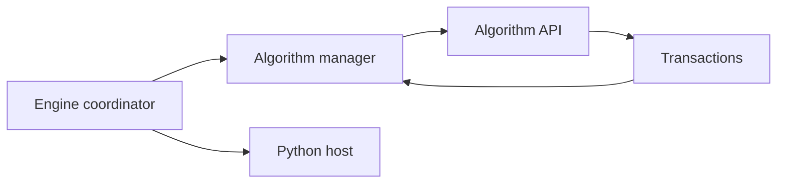
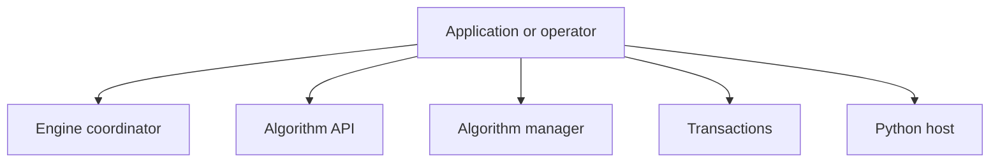
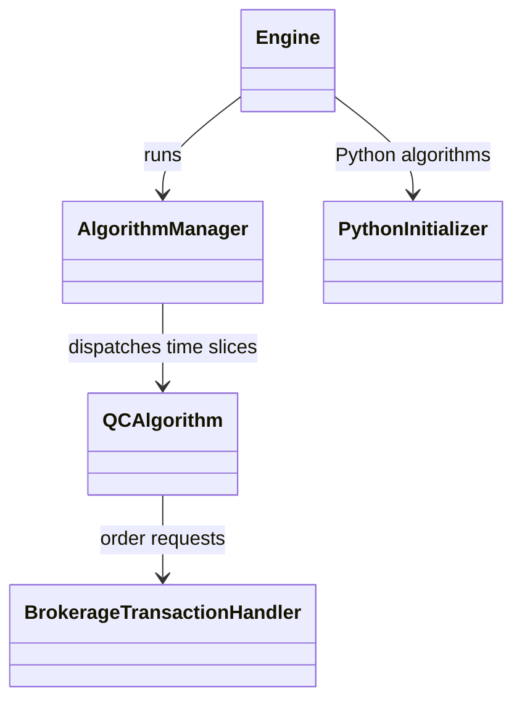
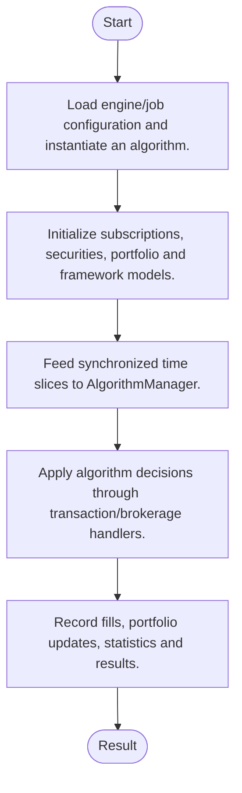
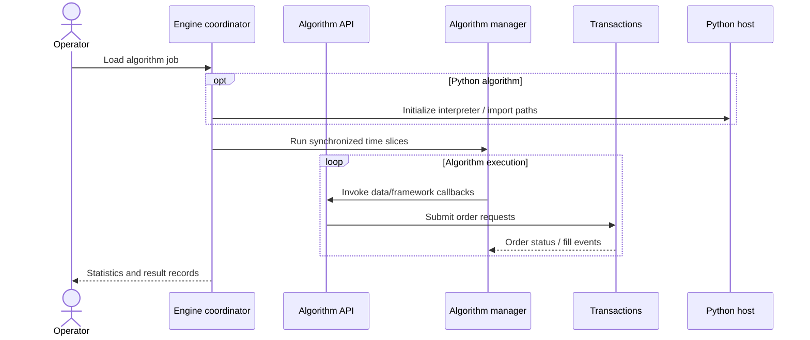
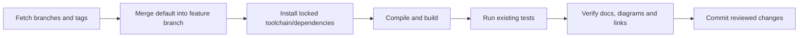

# lean: architecture, features and workflows

Updated: 2026-10-12 · Branch: `feature/ayu_develop` · Source snapshot: `ecb16172f`

[Development and layout](development.md) · [Validation evidence](validation.md) · [HTML edition](ayu-develop.html)

## Purpose and scope

QuantConnect LEAN is a C# algorithmic trading engine with Python algorithm integration. The engine assembles data feeds, algorithm execution, brokerage/transaction handling, real-time scheduling and results processing; an algorithm framework separates universe selection, alpha, portfolio construction, execution and risk management.

## Features

- C# and Python algorithm APIs over a common engine.
- Multi-asset securities, subscriptions and historical data processing.
- Indicators and consolidators for time-series analysis.
- Framework models separate alpha generation from portfolio, execution and risk decisions.
- Backtesting and live handlers share engine interfaces but have distinct data/time/brokerage implementations.

## Components and responsibilities

| Component | Responsibility | Implementation |
| --- | --- | --- |
| Engine coordinator | Assembles and runs algorithm execution handlers | [Engine/Engine.cs](../Engine/Engine.cs) |
| Algorithm API | Provides subscriptions, indicators, orders and portfolio access | [Algorithm/QCAlgorithm.cs](../Algorithm/QCAlgorithm.cs) |
| Algorithm manager | Advances time slices and calls algorithm callbacks | [Engine/AlgorithmManager.cs](../Engine/AlgorithmManager.cs) |
| Transactions | Processes order requests and brokerage fills | [Engine/TransactionHandlers/BrokerageTransactionHandler.cs](../Engine/TransactionHandlers/BrokerageTransactionHandler.cs) |
| Python host | Initializes Python and configures import paths | [Common/Python/PythonInitializer.cs](../Common/Python/PythonInitializer.cs) |

## Architecture and boundaries

The following view shows the principal responsibilities and their data-flow relationship. It is a conceptual architecture view; each implementation link above identifies the owning source. Native or external services retain their own lifecycle and configuration.



### Component ownership

The boundaries below distinguish entry points from their state/model and integration responsibilities. Data validation, numerical semantics and external protocol handling belong in the owning modules rather than in documentation or deployment scripts.



## Types and relationships

This diagram names types present in the linked source. Edges describe the documented relationship; they do not imply additional inheritance.



- [`QCAlgorithm`](../Algorithm/QCAlgorithm.cs)
- [`Engine`](../Engine/Engine.cs)
- [`AlgorithmManager`](../Engine/AlgorithmManager.cs)
- [`BrokerageTransactionHandler`](../Engine/TransactionHandlers/BrokerageTransactionHandler.cs)
- [`PythonInitializer`](../Common/Python/PythonInitializer.cs)

## Runtime workflow

1. Load engine/job configuration and instantiate an algorithm.
2. Initialize subscriptions, securities, portfolio and framework models.
3. Feed synchronized time slices to AlgorithmManager.
4. Apply algorithm decisions through transaction/brokerage handlers.
5. Record fills, portfolio updates, statistics and results.



## Sequence of a typical operation

This sequence expands the responsibility flow described above. The named participants correspond to the component table; error handling and any service-specific prerequisites remain part of the implementation.



## Development and verification workflow

Sync the upstream refs, merge the actual default branch into `feature/ayu_develop`, resolve conflicts, install the documented environment and run the existing build/test commands. Keep lockfiles and source changes together so another checkout can reproduce the environment.



### Commands

```sh
dotnet build QuantConnect.Lean.sln --configuration Release
dotnet test Tests/QuantConnect.Tests.csproj --configuration Release --no-build
```

The exact commands executed, interpreter/compiler versions, pass/fail counts and any prerequisites are recorded in [validation.md](validation.md). A syntax-only pass is reported separately from a package/native build and from runtime tests.

## Source navigation

These links refer to files in this checkout. They remain useful when the repository is opened locally; the source snapshot above identifies the revision used for this guide.

- [Engine/Engine.cs](../Engine/Engine.cs)
- [Algorithm/QCAlgorithm.cs](../Algorithm/QCAlgorithm.cs)
- [Engine/AlgorithmManager.cs](../Engine/AlgorithmManager.cs)
- [Engine/TransactionHandlers/BrokerageTransactionHandler.cs](../Engine/TransactionHandlers/BrokerageTransactionHandler.cs)
- [Common/Python/PythonInitializer.cs](../Common/Python/PythonInitializer.cs)
- [Algorithm.CSharp/AccordVectorMachinesAlgorithm.cs](../Algorithm.CSharp/AccordVectorMachinesAlgorithm.cs)
- [Algorithm.CSharp/AccumulativeInsightPortfolioRegressionAlgorithm.cs](../Algorithm.CSharp/AccumulativeInsightPortfolioRegressionAlgorithm.cs)
- [Algorithm.CSharp/AddAlphaModelAlgorithm.cs](../Algorithm.CSharp/AddAlphaModelAlgorithm.cs)
- [Algorithm.CSharp/AddAndRemoveOptionContractRegressionAlgorithm.cs](../Algorithm.CSharp/AddAndRemoveOptionContractRegressionAlgorithm.cs)
- [Algorithm.CSharp/AddAndRemoveSecuritySameLoopRegressionAlgorithm.cs](../Algorithm.CSharp/AddAndRemoveSecuritySameLoopRegressionAlgorithm.cs)
- [Algorithm.CSharp/AddBetaIndicatorNewAssetsRegressionAlgorithm.cs](../Algorithm.CSharp/AddBetaIndicatorNewAssetsRegressionAlgorithm.cs)
- [Algorithm.CSharp/AddBetaIndicatorRegressionAlgorithm.cs](../Algorithm.CSharp/AddBetaIndicatorRegressionAlgorithm.cs)
- [Algorithm.CSharp/AddFutureContractWithContinuousRegressionAlgorithm.cs](../Algorithm.CSharp/AddFutureContractWithContinuousRegressionAlgorithm.cs)
- [Algorithm.CSharp/AddFutureOptionContractDataStreamingRegressionAlgorithm.cs](../Algorithm.CSharp/AddFutureOptionContractDataStreamingRegressionAlgorithm.cs)
- [Algorithm.CSharp/AddFutureOptionContractFromFutureChainRegressionAlgorithm.cs](../Algorithm.CSharp/AddFutureOptionContractFromFutureChainRegressionAlgorithm.cs)
